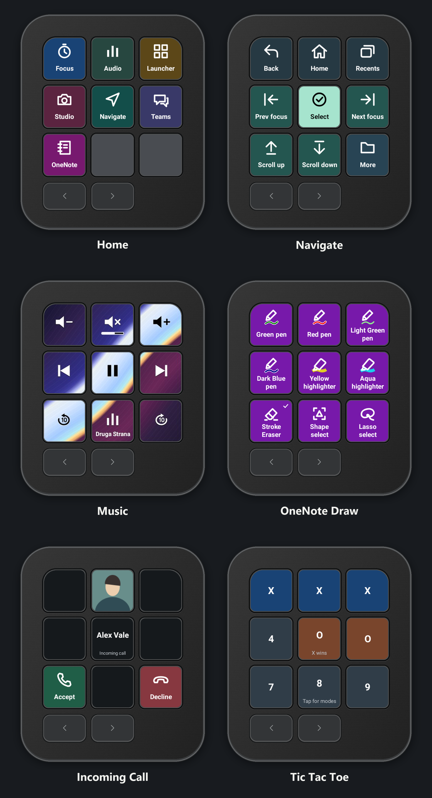

# MX Pocket

MX Pocket turns the **wired Logitech MX Creative Keypad** from a desktop
accessory into nine tactile controls for your Android phone. Over USB-C, the
phone changes what each key shows and does. No root or companion PC.

On the **Music** layout, press the center key to pause the track.
Switch to **Navigation**: that same key now says **Select**, and the key below
it says **Scroll down**. With [Android navigation access](docs/android-decks.md)
enabled, you can keep reading in a supported app without swiping the screen.



*LCD layouts on an illustrated keypad.*

The trick is under the keys: **one 480 × 480 LCD**, visible through nine
windows. A native Kotlin driver runs in Android userspace, reads key presses
over USB HID and sends JPEGs back to that panel. Two physical page buttons
switch layouts. The driver targets the wired Keypad, not the wireless Dialpad.

## Quick start

<a name="try-it-on-windows-without-hardware"></a>

**Try the two layouts on Windows.** From the repository root with `JAVA_HOME` set
to JDK 17 or 21 (x64 on Windows ARM64), run:

```powershell
.\gradlew.bat :desktop-preview:run
```

On **Home**, choose the profile with the music-note icon and click the center key to toggle playback.
Choose **Navigation** to see the same key become **Select**. The simulator
needs no Android SDK, phone or keypad; it doesn't change Windows media,
navigate other apps or drive USB hardware.

<a name="run-it-on-android"></a>

**[Try it on Android](docs/workspace.md#install-the-android-app)** with a
wired keypad or on-screen keys. Both run real phone actions.
**[Reuse the Kotlin driver](docs/driver.md)** in your own Android app.

<a name="guides"></a>

[Key layouts and permissions](docs/android-decks.md) · [Workflows](docs/workflows.md) · [Write a plugin](docs/plugins.md) · [Contribute](CONTRIBUTING.md)

The **Teams** profile opens the Android client on this phone. Choose **Call
tools** for its manual meeting page, or **Teams setup** for optional local call
status and switching. A Teams call notice is not proof you joined. Key 8 and
Teams setup distinguish a notice from a confirmed call. The in-app setting
defaults to on, but Teams still needs its own Android permissions. You can
turn call status off in Teams setup.
See [Teams call controls and client limits](docs/android-decks.md#teams-on-this-phone).

<a name="hardware-evidence-and-credits"></a>

## Credits

[MIT license](LICENSE). The [driver credits and upstream notices](mx-driver/src/main/assets/mx-pocket-provenance.txt)
trace the protocol to Julian Waller's `node-logitech-mx-creative-console` and
related open-source work. For what requires a real device, see the
[hardware checklist](docs/workspace.md#hardware-acceptance-manual-not-established-by-jvm-tests).
The Gradle wrapper is [Apache-2.0 licensed](LICENSES/Apache-2.0.txt); see [NOTICE](NOTICE).
